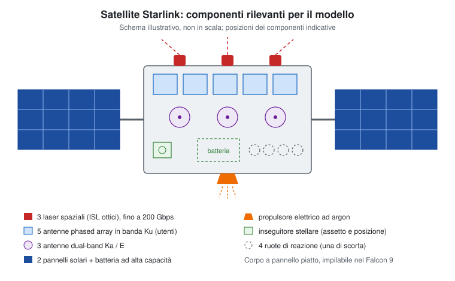

# TeraFlowSDN — laboratorio di migrazioni satellitari

Il programma confronta la migrazione **Hot e Cold** del controller TeraFlowSDN sullo stesso piano orbitale. Il progetto applicativo si trova in [`teraflow-migration-sim/`](teraflow-migration-sim/). La console locale è sulla porta **18092**.

## 1. Prerequisiti

Per il percorso Windows descritto qui servono:

- **Python 3.13** (versione usata nel progetto) e PowerShell.
- **Docker Desktop avviato con engine Linux** e Docker Compose disponibile.
- La copia completa del laboratorio: configurazioni, immagini Docker e artefatti congelati. Una sola copia del codice non contiene necessariamente gli archivi locali necessari; vedere il punto 3.
- Connessione Internet per installare le dipendenze e scaricare le immagini mancanti.

Durante la simulazione mantenere accesi PC, sessione Windows e Docker; evitare sospensione e riavvii. Le prove possono richiedere diverse ore, soprattutto al primo avvio con calibrazione.

Controllare gli strumenti in PowerShell:

```powershell
py -3.13 --version
docker version
docker compose version
```

`docker version` deve mostrare anche il server: un errore di connessione indica che il motore Docker non è disponibile.

## 2. Installare le dipendenze Python (solo la prima volta)

Aprire PowerShell e posizionarsi nella cartella applicativa. Nel percorso di questo workspace:

```powershell
cd C:\UNIFI-workspaces\satellite-simulation\teraflow-migration-sim
py -3.13 -m venv .venv
.\.venv\Scripts\python.exe -m pip install --upgrade pip
.\.venv\Scripts\python.exe -m pip install -r requirements.txt
```

Se il repository è stato copiato altrove, adattare soltanto il percorso del `cd`. Tutti i comandi successivi si eseguono da `teraflow-migration-sim`.

Non occorre attivare l'ambiente: i comandi usano direttamente il suo interprete. `requirements.txt` include anche le librerie per orbite e grafici del report. Negli avvii successivi riutilizzare `.venv`; dopo un aggiornamento delle dipendenze ripetere il comando di installazione.

## 3. Verificare che il laboratorio sia predisposto

Il comando di avvio usa `--no-build`: **non costruisce le immagini**. Prima devono essere disponibili le immagini TeraFlow con le patch previste, quelle del laboratorio Mininet/P4, i file P4 e il bundle di trasferimento referenziato dai manifest.

Verificare la configurazione e le immagini richieste:

```powershell
docker compose --env-file deploy/lab.env -p teraflow -f deploy/stack.yaml config --quiet
docker compose --env-file deploy/lab.env -p teraflow -f deploy/stack.yaml config --images
docker image ls
```

La configurazione richiede `deploy/lab.env` e `deploy/stack.yaml`. Conservare inoltre `config/scenario.json`, `config/fixture.json`, i manifest in `config/`, gli artefatti orbitali e gli archivi in `artifacts/` con i percorsi e checksum registrati. Non sostituire il bundle con un archivio generico: il motore verifica la provenienza degli input.

**Su una macchina nuova:** procurarsi gli artefatti congelati e importare le immagini dalla copia del laboratorio, oppure ricostruirli seguendo la [guida di deployment](teraflow-migration-sim/docs/teraflow-compose.md). `tools/build_tfs_images.py` costruisce le sei immagini upstream a partire dagli input già presenti in `.reference/` (`tfs-src.tar.gz`, `tfs-proto.tar.gz`, `common_requirements.in`, `common_requirements_py313.in`, `LICENSE`): non scarica quegli input e non prepara da solo le varianti Service/Device con patch e il bundle attualmente configurato. La sola build upstream non completa l'installazione live. Il repository non offre un unico comando per ricreare da zero tutti questi materiali.

Se immagini o archivi mancano, completare questa preparazione prima di proseguire. Per il laboratorio già predisposto non rigenerare fixture, costellazione o manifest a ogni avvio.

## 4. Avviare laboratorio e console

Con Docker Desktop pronto, dalla cartella `teraflow-migration-sim` eseguire:

```powershell
.\.venv\Scripts\python.exe tools/lab.py start
```

Il comando verifica che il motore Docker risponda, crea i volumi persistenti e avvia il gruppo Compose **teraflow** (SAT-A, SAT-B e Mininet/P4) attendendo che i servizi siano pronti. Poi avvia la console su **[http://127.0.0.1:18092/](http://127.0.0.1:18092/)** e la apre nel browser. Se un job o un recupero detiene il lock del laboratorio, lo stack resta invariato e viene avviata solo la console; se la console è già attiva, il comando apre soltanto la pagina. Un'immagine mancante o un servizio non pronto interrompe l'avvio prima della console e va risolto prima della simulazione.

Lasciare aperto questo terminale: la console resta in primo piano e si chiude con **Ctrl+C**, mentre i job proseguono nel worker. Usare un secondo PowerShell, sempre nella cartella applicativa, per altri comandi. Opzioni utili:

- `--no-stack` avvia solo la console, senza toccare Docker;
- `--no-browser` non apre il browser;
- `tools/lab.py status` mostra Docker, lock, container e console.

Le API NBI locali sono su `http://127.0.0.1:18080` (SAT-A) e `http://127.0.0.1:18081` (SAT-B). La sola risposta HTTP non certifica il corretto forwarding P4: il confronto verifica anche il servizio.

## 5. Comandi separati

`tools/lab.py start` equivale a `tools/stack.py up` seguito da `tools/serve_gui.py`. I due comandi restano disponibili, così come `tools/stack.py status`. Su Windows `teraflow-migration-sim\tools\start_gui.cmd`, aperto da Esplora file, avvia la sola console e richiede `.venv` già installato.

## 6. Avviare la simulazione Hot/Cold

1. Attendere il caricamento della console e controllare **Requisiti del laboratorio**. È ammesso un solo job alla volta.
2. Scegliere **Velocità utile del canale**: 100 Mbit/s, 1 Gbit/s oppure 10 Gbit/s. Per la prima prova si può mantenere 1 Gbit/s.
3. Premere **Avvia confronto Hot/Cold**.
4. Seguire **Il tuo esperimento** e la **Timeline del confronto**. Se mancano calibrazioni compatibili, usare **Crea scenario iniziale**: il programma predispone prima la rete completa, esegue le verifiche funzionali necessarie e due prove di calibrazione (Cold e Hot), riutilizzando l'inventario compatibile e ripristinando il servizio tra le prove. Dopo le misure prepara la partenza della simulazione sulla stessa rete.
5. Attendere la selezione automatica di satellite e istante iniziali. Durante preparazione e calibrazione il clock orbitale è fermo: la mappa immobile è prevista. Se non viene trovato un piano ammissibile, leggere il motivo registrato.
6. Il programma esegue **Hot → Ripristino → Cold** sullo stesso piano. L'obiettivo attuale è **tre migrazioni verificate per Hot e tre per Cold**, senza durata prefissata. Non occorre scegliere manualmente satellite, partenza o durata.
7. Alla conclusione controllare **Risultati del confronto** ed **Evento per evento**, quindi aprire o scaricare i file da **Report e dati**.

Un processo terminato non garantisce un confronto riuscito: verificare l'esito delle due modalità e il numero di migrazioni riuscite. `—` indica una misura mancante. Il downtime del controller e il ripristino del forwarding sono misure distinte; Cold−Hot viene mostrato solo per eventi confrontabili.

La [guida al flusso guidato](teraflow-migration-sim/docs/guided-flow.md) descrive preparazione, attese e interpretazione dei risultati. Le vecchie istruzioni basate su durata manuale e velocità fissa descrivono una versione precedente della console.

### Alternativa da riga di comando

Con il laboratorio avviato, la stessa operazione si può lanciare senza browser:

```powershell
.\.venv\Scripts\python.exe tools/experiment.py compare_continuous --rate-bps 1000000000 --wait
```

Sostituire la velocità con `100000000` oppure `10000000000` per le altre opzioni. Non avviare contemporaneamente il confronto da GUI. Per questo comando la partenza è automatica e `--duration-s` non imposta la durata del confronto attuale. `--wait` segue il job fino all'esito.

## 7. Consultare i risultati

I percorsi seguenti sono relativi a `teraflow-migration-sim/`:

- `results/continuous-comparisons/pair-*/`: piano condiviso, risultati, CSV e report HTML del confronto.
- `results/simulations/sim-*/`: dettagli delle sessioni Hot e Cold.
- `results/runs/run-*/`: evidenze delle singole migrazioni.
- `results/jobs/job-*/`: stato persistente, eventi e log del worker.

La console consente anche di selezionare confronti precedenti in **Storico e replay**. I report e le evidenze parziali restano disponibili anche dopo un fallimento. Orbite e FSO sono modellati; TCP, API, autorità P4 e sonde sono verificati live.

## 8. Interrompere, recuperare e spegnere

Per fermare una prova usare **Interrompi** nella console e attendere la messa in sicurezza. Chiudere la scheda non ferma il worker. Per controllare o interrompere da un secondo terminale:

```powershell
.\.venv\Scripts\python.exe tools/experiment.py jobs
.\.venv\Scripts\python.exe tools/experiment.py stop --job-id job-IDENTIFICATIVO
```

Sostituire `job-IDENTIFICATIVO` con l'ID effettivo. Se compare **Ripristino necessario**, usare **Ripristina laboratorio** e attendere. Per un worker morto con lock ancora presente:

```powershell
.\.venv\Scripts\python.exe tools/experiment.py recover --wait
```

Non cancellare manualmente `results/jobs/lab.lock`. Il recupero conclude la prova interrotta; una nuova simulazione richiede un nuovo avvio.

Quando non ci sono job attivi o recuperi pendenti, fermare il server con **Ctrl+C** nel suo terminale e arrestare il laboratorio:

```powershell
.\.venv\Scripts\python.exe tools/lab.py stop
```

Come `tools/stack.py stop`, il comando rifiuta l'arresto se il lock del laboratorio è presente. `tools/stack.py down` rimuove container e reti conservando i volumi persistenti; `stop` basta per lo spegnimento ordinario. Negli avvii successivi ripetere i punti **4 e 6**.

## Il satellite di riferimento: Starlink

Il modello prende come riferimento la struttura dei satelliti Starlink descritta da SpaceX nella pagina [Tecnologia satellitare](https://starlink.com/it/technology) (consultata il 7 novembre 2026). Il disegno riporta i componenti che contano per la simulazione; posizioni e proporzioni sono indicative.



| Componente (dichiarato da SpaceX) | Ruolo nella simulazione | Stato nel simulatore |
| --- | --- | --- |
| **3 laser spaziali** (collegamenti ottici intersatellitari, ISL), fino a 200 Gbps | Canale della migrazione e dei percorsi multi-hop fra satelliti | Da introdurre: al massimo 3 collegamenti FSO per satellite. Oggi il modello accetta ogni coppia entro 1.700 km, senza limite di terminali |
| **5 antenne phased array in banda Ku** | Collegamento con i terminali utente a terra | Non modellate. Candidate per la futura variante radio |
| **3 antenne dual-band Ka/E** | Collegamento con le stazioni di terra (gateway) | Non modellate. Candidate per la futura variante radio |
| **2 pannelli solari + batteria** | Il satellite è pienamente operativo solo al sole: l'ombra è l'evento che richiede la migrazione | Modellato come periodi di illuminazione dal replay orbitale |
| **Propulsore elettrico ad argon** | Innalzamento d'orbita, manovre e rientro a fine vita | Non modellato. Il replay usa orbite da TLE senza manovre |
| **Inseguitore stellare e 4 ruote di reazione** (una di scorta) | Assetto e puntamento, necessari anche per allineare i laser | Rappresentati solo dal tempo di allineamento FSO (60 s) |

Ipotesi e limiti da tenere presenti:

- La pagina indica il numero di laser ma non la loro assegnazione. Nel modello si ipotizza **2 laser verso i vicini dello stesso piano e 1 verso il piano adiacente**. È un'ipotesi di progetto, non un dato SpaceX.
- La portata dei laser **non è dichiarata**. I 1.700 km e i 60 s di allineamento sono parametri dello scenario (`config/scenario.json`), non specifiche Starlink.
- SpaceX indica una quota di circa 550 km. I due piani scelti per il nuovo scenario appartengono al guscio a 53° a circa 463 km, ricavato dai TLE del catalogo.
- Le orbite derivano da TLE pubblici, la cui accuratezza è limitata: i contatti vicini al limite di portata vanno considerati incerti (ESA, *Space Debris Mitigation for CubeSats and Smallsats*, ESA-TECQI-HO-2025-003724, 11/12/2025).
- Per la variante radio, le antenne Ka/E e Ku collegano il satellite con la Terra, non con altri satelliti. Una migrazione via radio passerebbe quindi da una stazione di terra (satellite → gateway → satellite), con portata, velocità e disponibilità diverse dal laser.

## Problemi frequenti

- **Python o `.venv` non trovato:** verificare il percorso corrente e completare il punto 2.
- **Docker non raggiungibile:** avviare Docker Desktop, selezionare engine Linux e attendere che `docker version` mostri il server.
- **Immagine, bundle o file mancante / checksum errato:** ripristinare gli artefatti previsti dai manifest (punto 3); non aggirare i controlli modificando i checksum.
- **Porta 18092 occupata:** verificare se la console è già avviata; usare l'istanza esistente oppure arrestarla prima di riavviare il server.
- **Pulsante di avvio disabilitato o laboratorio occupato:** controllare stato, job attivo ed eventuale richiesta di recupero.
- **Preparazione ferma o fallita:** leggere sottofase, ultimo progresso, scadenza e log del job; non avviare altre operazioni Docker durante una prova.
- **Conflitto di subnet Docker:** vedere le variabili di rete in `deploy/lab.env` nella guida di deployment.

## Documentazione e verifiche locali

- [Guida al confronto guidato attuale](teraflow-migration-sim/docs/guided-flow.md)
- [Deployment e immagini Docker](teraflow-migration-sim/docs/teraflow-compose.md)
- [Guida operativa e strumenti CLI avanzati](teraflow-migration-sim/docs/operating-guide.md)
- [Descrizione tecnica](teraflow-migration-sim/README.md)
- [Stato di implementazione e limiti delle misure](teraflow-migration-sim/docs/implementation-status.md)

Per eseguire i test locali dalla cartella applicativa:

```powershell
.\.venv\Scripts\python.exe -m unittest discover -s tests -v
```

I test locali non certificano il completamento della campagna live. La vecchia dashboard sulla porta 8081 è stata rimossa; l'unico frontend è la console sulla porta 18092.
